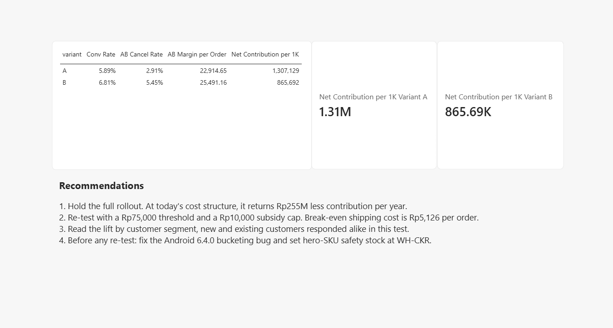
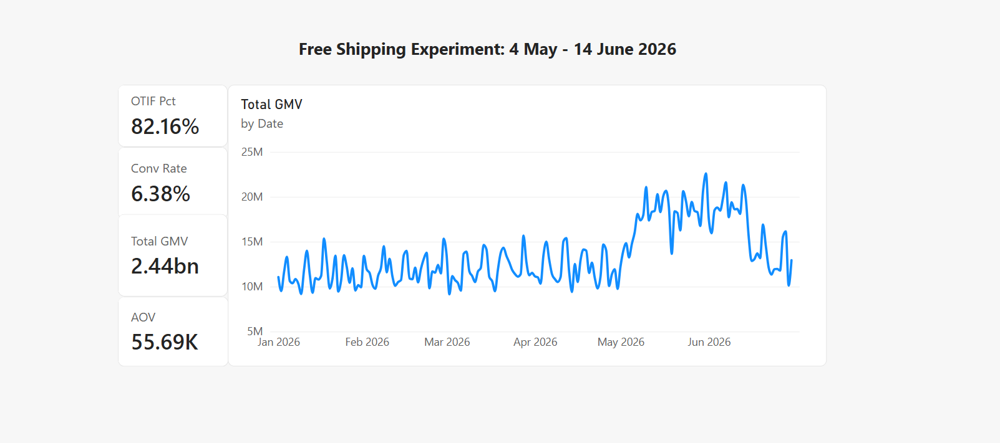
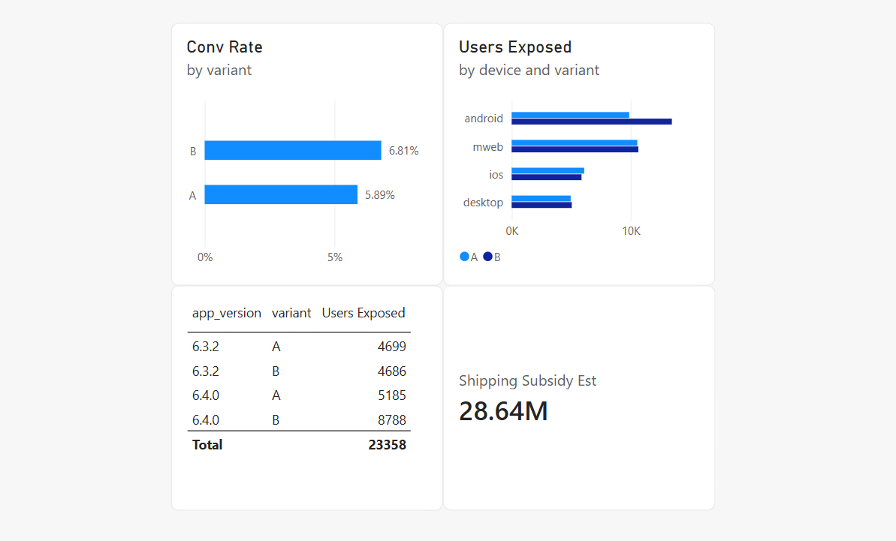
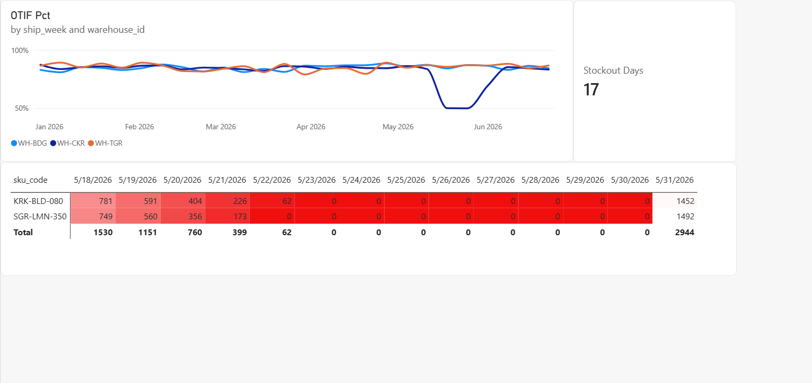
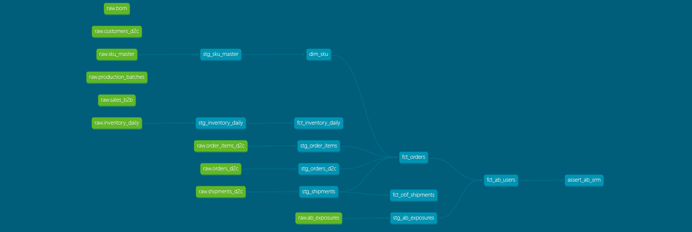

# NetLift: A/B Experiment Audit for an FMCG D2C Store

> The free-shipping variant won on conversion and basket size. At full rollout it would still return about Rp255M less contribution per year than not running it. This repository is the audit that found out why.

**Stack:** PostgreSQL, dbt, Python (pandas, SciPy), Power BI

**Domain:** FMCG manufacturing and direct-to-consumer marketplace sales, Cikarang, Indonesia

**Data:** synthetic and fully reproducible (`seed=42`), see [About the data](#about-the-data)

**How it was built:** with a written project guide and an AI assistant (Claude) as reviewer, who did what is documented in [`docs/self-exam.md`](docs/self-exam.md)



## The problem

PT Nusa Rasa Abadi is a fictional snack and beverage manufacturer that sells direct to consumers through its official store on a marketplace. Its Growth team ran a six-week experiment, from 4 May to 14 June 2026, on 66,570 users: variant A kept the usual shipping fee, and variant B offered free shipping on orders of at least Rp50,000.

On the growth dashboard, B won clearly. Conversion rose from 5.893% to 6.809% (+15.5% relative) and average order value from Rp55,440 to Rp62,301 (+12.4%), both significant at p < 0.001. A full rollout was being prepared. My job was to audit the data before that decision.

## Key findings

1. **The randomisation was broken.** Android build 6.4.0 sent 62.9% of its users to variant B (z = 30.5), while build 6.3.2 split a clean 49.9%. Across all users, B received 52.66% (chi-square 188.9). The lift still shows on Android, iOS and mobile web (+0.91 to +1.25 points) and is not detectable on desktop (+0.08), so its direction is reliable but its exact size is less certain.
2. **Part of the win was novelty.** B's conversion fell from 7.53% in weeks 1-2 to 6.74% in weeks 3-4 and 6.11% in weeks 5-6. A test stopped at week 2 would have projected far too optimistically.
3. **The unit economics are negative.** Each free-shipping order absorbs about Rp12,000 of shipping that A's customers paid themselves. After that subsidy, B's net value per order is Rp13,491 against Rp22,915 for A. Per 1,000 exposed users, B returns Rp442,543 less contribution, about Rp255M a year at full rollout. Of B's 68 orders per 1,000 users, only about 9 were added by the offer; the rest would likely have happened anyway.
4. **Operations broke the guardrails.** Cancellations nearly doubled, from 2.91% to 5.45%. The extra cancellations came from orders for the two hero SKUs placed 18-31 May, while their stock at the Cikarang warehouse ran out (22/23 to 30 May), and B's baskets held those SKUs far more often (78% of orders versus 20%). Separately, that warehouse's OTIF fell from about 85% to 68.8% in May. 1,615 of its 1,806 failures that month were late but complete deliveries, and orders with and without the hero SKUs were late at nearly the same rate, so the cause was promo load, not the stockout.

## Recommendation

**Hold the rollout.** Re-test with a Rp75,000 threshold and a Rp10,000 subsidy cap: the promo only breaks even if shipping cost falls to Rp5,126 per order. Before any re-test, fix the Android 6.4.0 bucketing bug and set safety stock for the hero SKUs. Days of cover for KRK-BLD-080 had already fallen below 7 on 17 May, six days before stock hit zero.

The full write-up is in [`docs/business-analysis.md`](docs/business-analysis.md), and the memo to the Head of Growth is in [`docs/memo-growth.md`](docs/memo-growth.md).

## Dashboard

Four pages in Power BI (`netlift.pbix`):

1. **Executive summary:** GMV, AOV, conversion and OTIF, with the experiment window marked.
2. **A/B experiment:** conversion by variant, and the user split by device and app version, where the SRM is visible.
3. **Supply chain and OTIF:** weekly OTIF by warehouse and hero-SKU stock at the Cikarang warehouse.
4. **Unit economics and recommendations:** net contribution per variant and the four recommendations (shown at the top of this page).

<details>
<summary>Screenshots of pages 1 to 3</summary>







</details>

## Architecture



| Layer | Schema | Built by | Contents |
|---|---|---|---|
| Raw | `raw` | `scripts/create_raw_tables.sql`, `scripts/load_raw.py` | 11 tables loaded from CSV, every column TEXT so nothing is lost or silently converted |
| Staging | `analytics_staging` | dbt, 6 views | cleaning rules for the planted faults: deduplication, timestamp normalisation, price parsing, return flags, unit conversion, bot and leakage flags |
| Marts | `analytics_marts` | dbt, 5 tables | `dim_sku`, `fct_orders`, `fct_ab_users`, `fct_otif_shipments`, `fct_inventory_daily` |

On top of the marts: 15 SQL problems with commented solutions in [`sql/`](sql/), the statistical readout in [`scripts/ab_analysis.py`](scripts/ab_analysis.py), and the Power BI dashboard.

## What the dbt tests show

`dbt test` ends with `PASS=8 WARN=1 ERROR=1`. Both alarms are intended:

- **WARN:** `source_unique_raw_orders_d2c_order_id` flags 307 duplicate order IDs in the raw layer, while `unique_fct_orders_order_id` passes in the mart. The duplicates exist at the source, and the cleaning layer removes them.
- **ERROR:** `assert_ab_srm` fails on purpose. This singular test catches the Android 6.4.0 bucketing bug, and it should keep failing until that bug is fixed upstream.

## Data quality and honest score

The generator plants 18 faults, each marked `FAULT` in [`scripts/generate_data.py`](scripts/generate_data.py). The project's answer key lists 20 codes: those 18, with the mis-padded SKU and the `SKU-TEST` rows counted separately, plus the Android 6.4.0 bucketing bug, which is planted in the assignment logic rather than marked. Every code, its impact and the decision taken are in [`docs/profiling-findings.md`](docs/profiling-findings.md).

Honest score, from [`docs/self-exam.md`](docs/self-exam.md): 19 of the 20 codes appear in my profiling notes, but they are not independent finds, because the project guide showed what each check should reveal. The one I missed was the SRM, which only shows when the split is compared across device and app version; the `assert_ab_srm` test caught it later. The same page explains how the work was divided between me and the AI assistant I used as a reviewer.

## Working like a team member

The analysis sits inside a simulated first month on the job, written up in [`docs/`](docs/):

- [`stakeholder-map.md`](docs/stakeholder-map.md): who needs which number, and how to say it to them.
- [`tickets/`](docs/tickets/): four ad-hoc requests from Growth, Finance, Supply Chain and Product, each answered as the real question, assumptions, answer and limitations.
- [`incidents/`](docs/incidents/): two simulated incident postmortems, a GMV jump caused by a loader rerun that duplicated data, and an OTIF figure that moved after a staging fix.
- [`memo-growth.md`](docs/memo-growth.md): the memo that tells the Head of Growth why the winning variant should be held and re-tested, in under 400 words.

## About the data

All data is synthetic, produced by [`scripts/generate_data.py`](scripts/generate_data.py) with `seed=42`. It models a Cikarang FMCG producer and its D2C marketplace sales from 1 January to 30 June 2026, in 11 tables: orders, order items, customers, SKUs, A/B exposures, shipments, daily inventory, B2B sales, distributors, production batches and bills of materials. With the package versions pinned in `requirements.txt`, running the script again reproduces every number in this repository exactly.

The generator ends with a self-check on its ground-truth rows, computed before the faults are injected: 67,000 users, with conversion of 5.90% versus 6.79%. The pipeline keeps 66,570 users, because it also excludes the 430 users still exposed to both variants after the test-window filter (it cannot tell which variant they truly saw), so its figures differ slightly from the self-check.

The figures validate the pipeline against a known ground truth. They are not claims about real customers or real revenue.

## How to run

Tested on Windows 10 with Python 3.11 and PostgreSQL 18.4 on x86_64-windows. The commands are for PowerShell, run from the repository root.

1. **Python environment**

   ```powershell
   python -m venv venv
   .\venv\Scripts\Activate.ps1
   pip install -r requirements.txt
   ```

2. **Database.** Create an empty PostgreSQL database named `nusarasa_dw`, then run [`scripts/create_raw_tables.sql`](scripts/create_raw_tables.sql) in it to create the `raw` schema and its 11 tables. Copy the credentials template and fill it in, without quotes around the values:

   ```powershell
   Copy-Item .env.example .env
   ```

3. **Generate and load the raw data**

   ```powershell
   python scripts\generate_data.py
   python scripts\load_raw.py
   ```

   The generator writes 11 CSV files to `data/raw/`. The loader truncates and refills each raw table, so running it twice gives the same result.

4. **dbt models and tests.** dbt reads its connection from `~/.dbt/profiles.yml`, which stays outside the repository:

   ```yaml
   netlift:
     target: dev
     outputs:
       dev:
         type: postgres
         host: localhost
         port: 5432
         user: postgres
         password: "{{ env_var('DBT_PG_PASSWORD') }}"
         dbname: nusarasa_dw
         schema: analytics
         threads: 4
   ```

   dbt does not read `.env`, so set the password as a Windows user variable once, then open a new terminal:

   ```powershell
   [Environment]::SetEnvironmentVariable("DBT_PG_PASSWORD", "your_password", "User")
   ```

   ```powershell
   cd dbt
   dbt debug
   dbt run
   dbt test
   cd ..
   ```

   Expect 11 models and `PASS=8 WARN=1 ERROR=1`, explained above. `fct_ab_users` takes about four minutes; every other model finishes in seconds.

5. **Statistical readout**

   ```powershell
   python scripts\ab_analysis.py
   ```

   This reads the marts. `python scripts\ab_analysis.py --csv` runs the same analysis straight from the raw CSVs, with the cleaning done in pandas, and prints the same figures.

6. **Dashboard.** Open `netlift.pbix` in Power BI Desktop. If your server is not `localhost:5432`, change it under **Transform data > Data source settings > Change Source**.

## Repository structure

| Path | Contents |
|---|---|
| `scripts/` | `generate_data.py`, `create_raw_tables.sql`, `load_raw.py`, `ab_analysis.py` |
| `dbt/` | dbt project: 6 staging models, 5 marts, and tests including `assert_ab_srm` |
| `sql/` | 15 SQL problems with commented solutions, `s1` to `s15` |
| `docs/` | business analysis, memo, profiling findings, self-exam, stakeholder map, tickets and incidents |
| `img/` | dashboard screenshots and the dbt lineage graph |
| `netlift.pbix` | Power BI dashboard |
| `requirements.txt`, `.env.example` | pinned Python packages and the credentials template |

## Limitations and next steps

- The Rp12,000 subsidy is a proxy based on what variant A customers paid (Rp11,829 on average), not a carrier's contract rate, and the conclusion is sensitive to it. Getting the real rate comes before any re-test.
- Rp255M annualises six weeks of traffic over 52 weeks; seasonality is not modelled.
- The dashboard shows contribution per 1,000 users about 0.3% lower than the script, because it sums the actual margins of completed orders while the script multiplies the average margin by the number of completed orders. The conclusion is the same.
- `fct_ab_users` takes about four minutes to build while every other model takes seconds. It is the next model to optimise.

## License

Code is released under the [MIT License](LICENSE). The dataset is synthetic and generated by the code in this repository.
